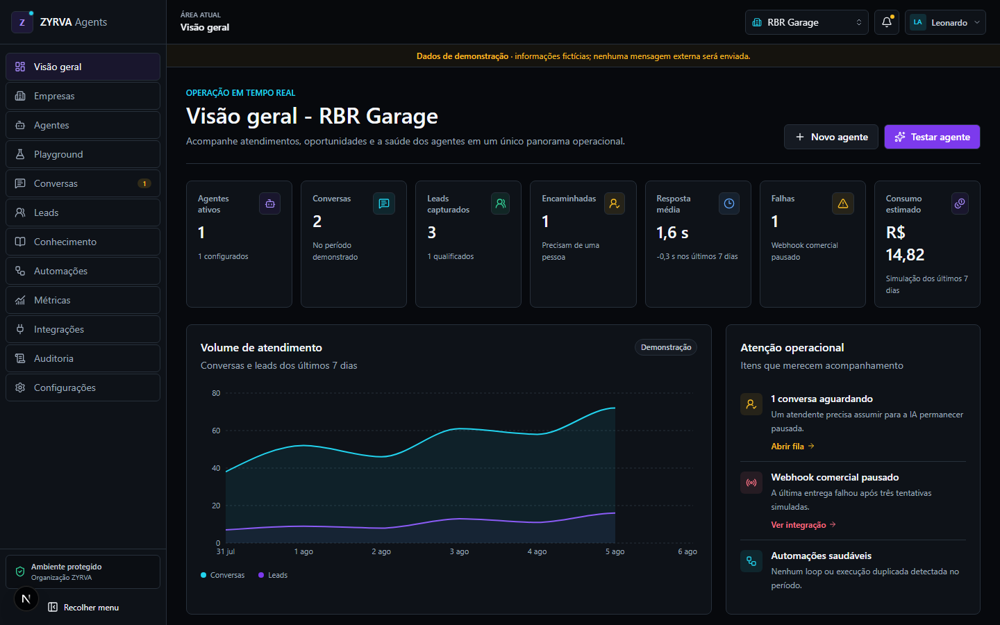
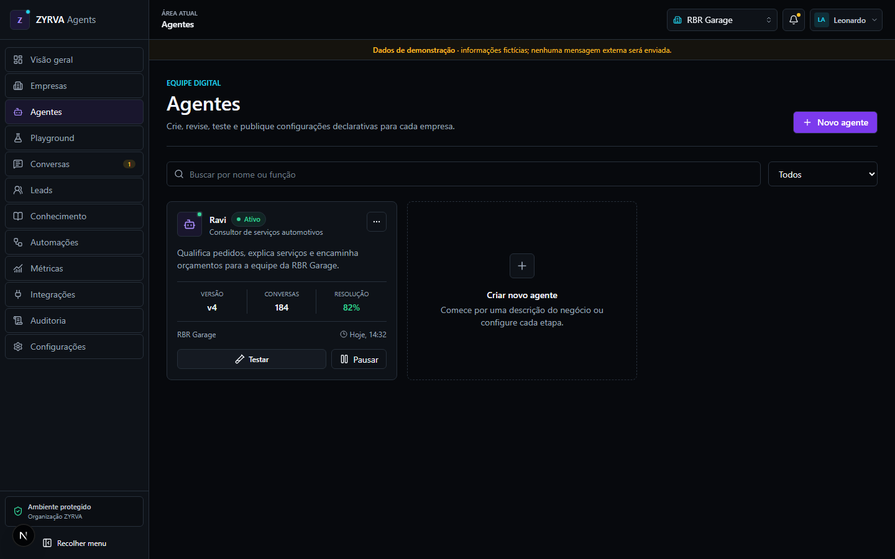
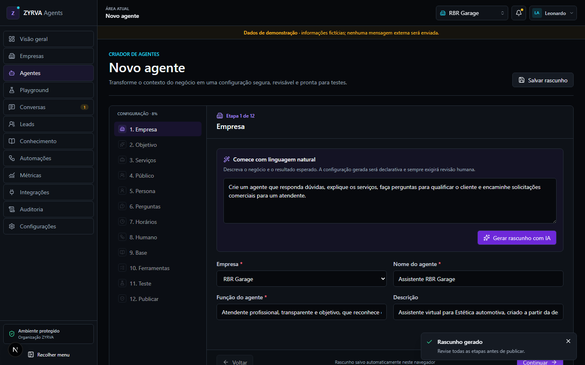
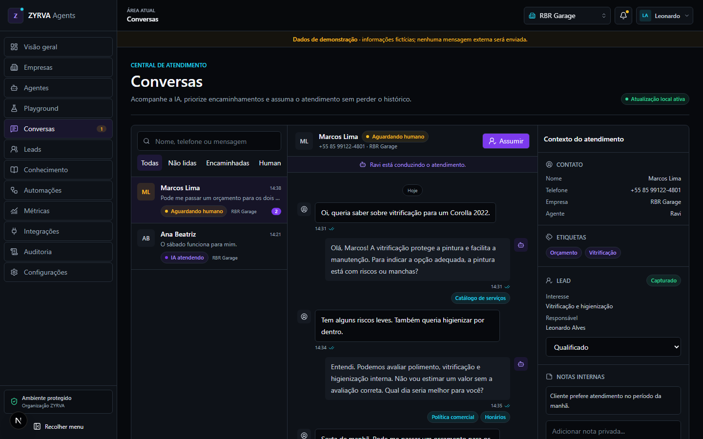
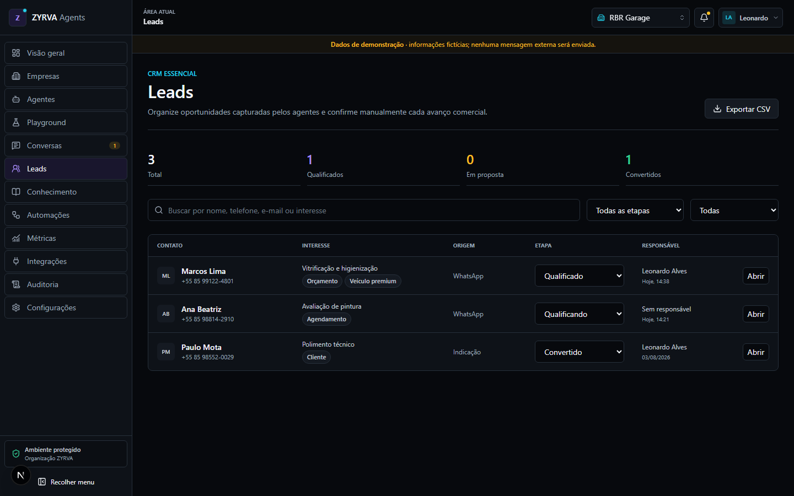

# Zyrva Company

**A multi-tenant platform for designing, testing, and operating AI-assisted customer service agents.**

Zyrva Company is a software engineering and applied AI portfolio project. It explores how a business can configure an assistant, evaluate its behavior, capture commercial opportunities, and transfer a conversation to a human operator without losing context.

The repository is intentionally honest about its maturity: the complete product experience runs locally in a deterministic demo mode, while the PostgreSQL, Redis, OpenAI, and WhatsApp foundations are implemented or documented at different levels of readiness and still require real-provider validation before commercial use.

## Why this project exists

Small and medium-sized businesses often handle customer service across disconnected tools. Valuable context is lost between automated replies, lead qualification, and human support, while deploying an AI agent safely requires more than connecting a model to a chat window.

Zyrva investigates a more controlled approach:

- model the business, agent, knowledge, channel, conversation, and audit boundaries explicitly;
- generate declarative agent configurations that remain reviewable by a person;
- keep AI and human ownership visible throughout a conversation;
- isolate every business through a multi-tenant data model;
- treat provider calls, tools, retrieved documents, and webhook payloads as untrusted inputs;
- provide a realistic local demo without requiring paid OpenAI or Meta accounts.

## Current status

| Area | Status | What is available |
| --- | --- | --- |
| Product interface | Implemented in demo mode | Responsive dashboard, companies, agents, playground, conversations, leads, knowledge, automations, metrics, integrations, audit, and settings |
| Agent builder | Implemented in demo mode | 12-step wizard, deterministic draft generation, validation, local draft recovery, review, and simulated publishing |
| Conversation engine | Implemented in demo mode | Intent/confidence output, source references, lead extraction, guardrails, and human handoff simulation |
| Local persistence | Implemented in demo mode | Validated Zustand state persisted in the browser, including recovery from incompatible or corrupted state |
| PostgreSQL model | Implemented as schema and migration | Prisma schema, tenant-aware relations, audit/usage records, and pgvector knowledge chunks |
| Meta webhook ingestion | Backend foundation implemented | Signature verification, durable deduplication, BullMQ queueing, retries, tenant resolution, and inbound/status persistence |
| OpenAI integration | Partially implemented | Structured Responses API adapter and production builder path; runtime conversation flow is not connected end to end |
| WhatsApp automation | Not production-ready | Incoming events can be processed, but automatic AI replies and outbound delivery are not completed or validated with a real Meta asset |
| Automations and knowledge ingestion | UI/prototype only | No production dispatcher, safe file parser, embedding pipeline, antivirus, or URL sandbox yet |
| Production authentication | Not implemented | The public credential is demo-only; no production IdP, invitations, MFA, recovery, or session revocation |

## Implemented features

### Product and UX

- Multi-company dashboard with operational metrics, charts, alerts, and estimated usage.
- Company context selector and demo company management.
- Agent catalogue with status, version, conversation, and resolution indicators.
- Twelve-stage agent builder covering purpose, services, audience, persona, questions, schedule, handoff, knowledge, tools, testing, and publication.
- Playground with deterministic responses, confidence, intent, sources, lead capture, and escalation decisions.
- Human-support inbox with assignment, internal context, lead stage, notes, and AI pause/resume controls.
- Lightweight lead CRM with filters, stage updates, ownership, consent, and CSV export protected against spreadsheet formula injection.
- Knowledge, automation, metrics, integrations, audit, configuration, privacy, terms, and data-request views.
- Desktop and mobile flows with automated WCAG A/AA checks on login and dashboard.

### Backend and security foundations

- Server-side demo sessions signed with JOSE and protected dashboard routes.
- Role and permission matrix for organization-scoped operations.
- Zod schemas at API and AI boundaries.
- OpenAI Responses API adapter with structured output, source-scope validation, action policy, confidence thresholds, and forced handoff rules.
- Meta webhook verification using HMAC over the raw request body.
- PostgreSQL-backed event idempotency and Redis/BullMQ asynchronous processing.
- Tenant-bound persistence for contacts, conversations, messages, usage, delivery status, and webhook processing state.
- Security headers including CSP, clickjacking protection, MIME sniffing protection, referrer policy, and permissions policy.
- Rate limiting, structured Pino logs, secret redaction, safe error responses, and fail-closed production configuration.

## Interface

All screenshots below were captured automatically from the running application in <code>APP_MODE=demo</code>. The data is fictional and no external message was sent.

### Agent management

### Agent creation workflow

### Human support inbox

### Lead CRM

## Architecture

Zyrva is a modular Next.js application with a separate asynchronous worker for provider events. Demo adapters make the product evaluable without external services; production adapters are selected only by server-side configuration.

~~~mermaid
flowchart LR
    Operator[Operator] --> Web[Next.js dashboard and APIs]
    Customer[WhatsApp customer] --> Meta[Meta Cloud API]
    Meta -->|signed webhook| Web
    Web --> PG[(PostgreSQL + pgvector)]
    Web --> Redis[(Redis + BullMQ)]
    Worker[Meta webhook worker] --> Redis
    Worker --> PG
    Builder[Agent builder] --> OpenAI[OpenAI Responses API]
    Web -. demo mode .-> Local[Zustand + deterministic engine]
~~~

### Main boundaries

1. **Interface:** App Router pages and accessible React components display authorized product state.
2. **API:** Route handlers validate input, session, tenant, permissions, rate limits, and provider signatures.
3. **Domain:** Declarative schemas and deterministic services encode agent, conversation, handoff, and webhook rules.
4. **Persistence:** Prisma repositories receive tenant context explicitly; composite constraints reduce cross-company references.
5. **Async processing:** BullMQ acknowledges webhooks quickly and delegates retryable work to a dedicated worker.
6. **AI/provider adapters:** OpenAI and Meta contracts are isolated from domain types and cannot be selected by the browser.

## Technology stack

| Layer | Technology |
| --- | --- |
| Web application | Next.js 16.4, React 19.2, strict TypeScript 5.9 |
| UI | Tailwind CSS 4, Lucide icons, Recharts |
| Client state | Zustand 5 with validated persistence |
| Validation and auth | Zod 4.6, JOSE/JWT |
| Database | PostgreSQL 17, Prisma 7.10, pgvector 0.8 |
| Queue | Redis 8.2, BullMQ 6 |
| AI | OpenAI SDK 7, Responses API, structured outputs, embeddings schema |
| Observability | Pino structured logging and audit/usage models |
| Tests | Vitest 4.1, Playwright 1.62, Testing Library, axe-core |
| Runtime and delivery | Node.js 24, Docker multi-stage build, Docker Compose |

## Repository structure

~~~text
src/app/                 Next.js pages, layouts, API routes, and proxy
src/components/          Product views and reusable UI components
src/modules/             Domain schemas and deterministic services
src/lib/server/          Auth, Prisma, OpenAI, Meta, queue, logging, HTTP
src/data/                Fictional demo fixtures
prisma/                  Schema, migration, seed, and channel provisioning
tests/unit/              Domain and adapter tests
tests/integration/       API and Prisma contract tests
tests/e2e/               Desktop, mobile, security, and accessibility flows
docs/                    Architecture, operations, security, and screenshots
~~~

## Run the demo locally

### Requirements

- Node.js 24 LTS
- npm compatible with the committed lockfile

PostgreSQL, Redis, OpenAI, and Meta credentials are **not required** for demo mode.

### Windows PowerShell

~~~powershell
git clone https://github.com/leleomuniz/zyrva-company.git
Set-Location zyrva-company
Copy-Item .env.example .env
npm ci
npm run db:generate
npm run dev
~~~

### macOS or Linux

~~~bash
git clone https://github.com/leleomuniz/zyrva-company.git
cd zyrva-company
cp .env.example .env
npm ci
npm run db:generate
npm run dev
~~~

Open [http://localhost:3000](http://localhost:3000) and use the public demo account:

~~~text
Email:    leonardo@zyrva.demo
Password: ZyrvaDemo!2026
~~~

The credential is intentionally public and is accepted only in demo mode. Demo records are fictional and browser-local.

## Optional Docker environment

Docker Compose can start the application, PostgreSQL/pgvector, migrations, seed, and Redis together:

~~~powershell
Copy-Item .env.example .env
docker compose --profile demo up --build
~~~

Stop the environment without deleting volumes:

~~~powershell
docker compose down
~~~

Use <code>docker compose down -v</code> only when you intentionally want to delete all local database and Redis data.

## Quality checks

~~~powershell
npm run lint
npm run typecheck
npm run test
npm run build
~~~

The complete local validation currently covers:

- **50 unit/integration tests** across 9 Vitest suites;
- **16 end-to-end tests** across desktop Chromium and a mobile viewport;
- authentication and forged-session rejection;
- corrupted persisted-state recovery;
- company, knowledge, agent publication, lead capture, and human handoff flows;
- responsive layout and selected WCAG A/AA accessibility checks;
- API security headers;
- production build and dependency audit.

For the browser suite:

~~~powershell
npx playwright install chromium
npm run test:e2e
~~~

Playwright starts the local development server automatically. External providers are not required in demo mode.

Useful commands:

| Command | Purpose |
| --- | --- |
| <code>npm run check</code> | Lint, typecheck, Vitest, and production build |
| <code>npm run test:coverage</code> | Generate V8 coverage reports |
| <code>npm run db:generate</code> | Generate the Prisma Client |
| <code>npm run db:deploy</code> | Apply committed migrations |
| <code>npm run db:seed</code> | Insert/update fictional demo scenarios |
| <code>npm run db:studio</code> | Inspect the local database |
| <code>npm run db:provision-meta</code> | Bind an existing tenant/company/agent to a Meta phone number |
| <code>npm run worker:meta</code> | Run the production-only Meta queue consumer |

## Demo and production boundaries

| APP_MODE | Behavior |
| --- | --- |
| <code>demo</code> | Enables the local credential, fictional fixtures, deterministic agent generation, and simulated conversation engine |
| <code>production</code> | Disables demo authentication and fails closed when required secrets or persisted repositories are unavailable |

Important implementation boundaries:

- Dashboard mutations currently persist in browser storage, not PostgreSQL.
- The production agent-list repository and runtime OpenAI conversation engine intentionally fail closed because they are not connected yet.
- The OpenAI adapter is used by the production builder path, but no real-key acceptance test is included in this repository.
- The Meta worker validates and persists inbound/status events, then places the conversation in human handoff; it does not generate or send an automatic AI reply.
- UI automation definitions do not execute external effects.
- PDF, DOCX, CSV, and URL ingestion is incomplete; safe parsing, malware checks, SSRF controls, chunking, and embedding jobs remain future work.

## Security model and limitations

Implemented controls include tenant-aware repositories, composite database constraints, permission checks, raw-body webhook signatures, durable idempotency, structured validation, security headers, log redaction, and production fail-closed behavior.

This repository is **not a security certification**. Before handling real customer data, the project still needs:

- a production identity provider, invitation flow, MFA, recovery, and revocable sessions;
- distributed rate limiting for multiple replicas;
- managed secrets and encrypted per-channel credentials;
- PostgreSQL RLS or equivalent defense in depth;
- file scanning and sandboxed knowledge ingestion;
- centralized monitoring, alerting, traces, and an operational dead-letter/replay workflow;
- tested backups, disaster recovery, key rotation, retention, export, and deletion procedures;
- legal review of privacy, consent, retention, international transfer, Meta, and OpenAI terms.

Never place provider keys in <code>NEXT_PUBLIC_*</code>, commit a real <code>.env</code>, or paste customer content and tokens into issues.

## Roadmap

- Persist company, agent, knowledge, lead, automation, and settings workflows through authenticated APIs.
- Add production authentication, invitations, membership management, and session revocation.
- Connect the runtime OpenAI path with tenant-scoped retrieval, evaluations, budgets, and circuit breakers.
- Build safe document ingestion, chunking, embeddings, semantic retrieval, and source lifecycle management.
- Complete WhatsApp outbound messages, delivery state, templates, opt-in rules, and Embedded Signup.
- Implement an audited automation/tool dispatcher with confirmation and kill switches.
- Add distributed rate limits, centralized observability, queue operations, backup/restore drills, and load tests.
- Add billing, plan quotas, cost dashboards, and production onboarding.

## API surface

| Method and route | Purpose |
| --- | --- |
| <code>GET /api/health</code> | Application configuration health |
| <code>POST /api/auth/demo</code> | Local demo authentication only |
| <code>POST /api/auth/logout</code> | Expire the session cookie |
| <code>GET /api/agents</code> | Demo agent listing; persisted production repository pending |
| <code>POST /api/agents/generate</code> | Generate a declarative agent configuration |
| <code>POST /api/playground/message</code> | Run the deterministic demo conversation engine |
| <code>GET /api/webhooks/meta</code> | Meta webhook verification challenge |
| <code>POST /api/webhooks/meta</code> | Receive signed WhatsApp webhook events |

## Documentation

- [Architecture](docs/architecture.md)
- [Data model](docs/data-model.md)
- [OpenAI adapter and AI safety](docs/openai.md)
- [Meta WhatsApp webhook and worker](docs/meta-whatsapp.md)
- [Deployment and operations](docs/deployment.md)
- [Security and LGPD](docs/security-lgpd.md)
- [Decisions and known limitations](docs/decisions-and-limitations.md)
- [Production and client checklists](docs/production-checklists.md)

Provider policies, model names, prices, and API limits change over time. Revalidate the official documentation before any production deployment.

## Author

Built as a software engineering and generative AI portfolio project by [Leonardo Muniz](https://github.com/leleomuniz).
