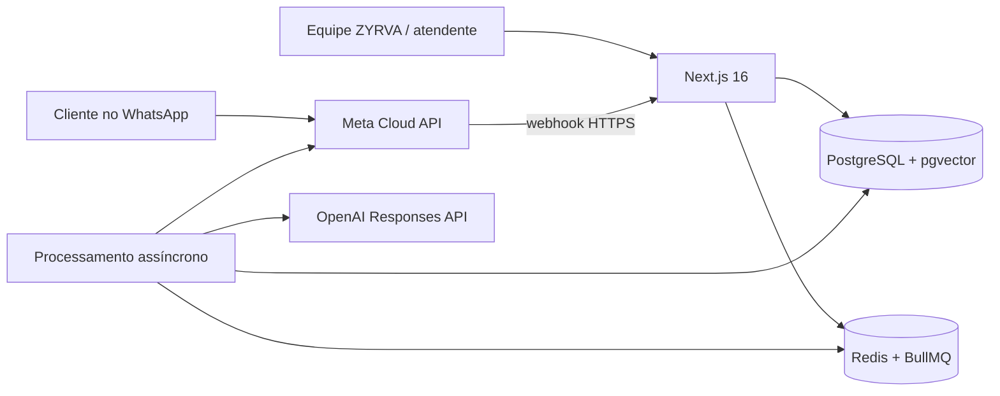
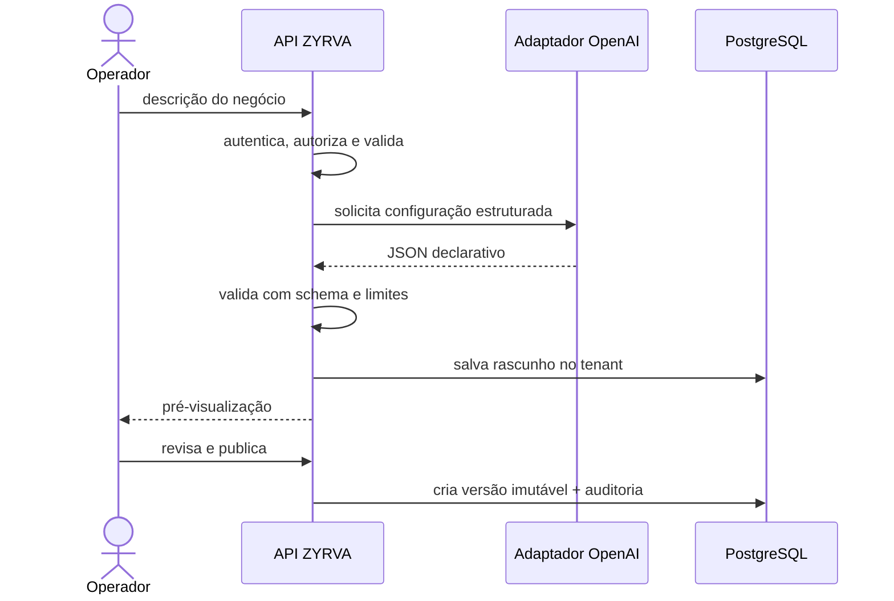
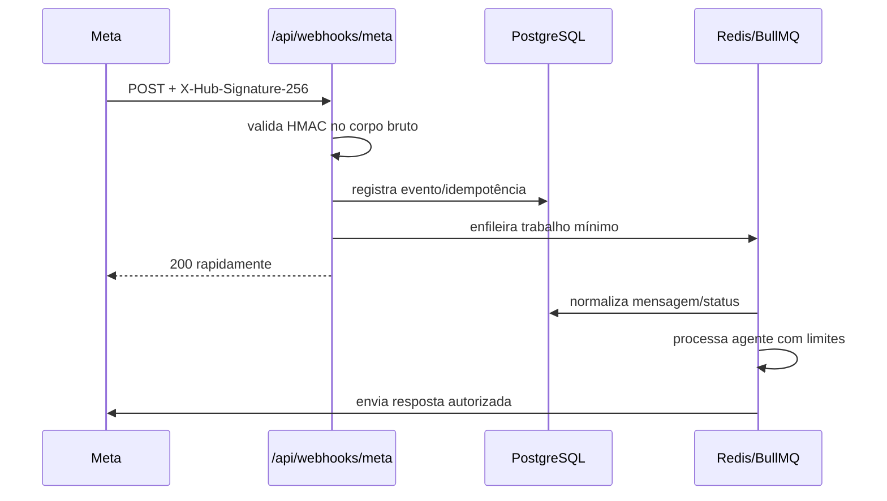

# Arquitetura do ZYRVA Agents

Atualizado em 06/08/2026. Este documento descreve a arquitetura-alvo do MVP e diferencia o que é executado localmente do que depende de provedores externos.

## Objetivos

- entregar um fluxo comercial completo antes de ampliar canais e automações;
- manter isolamento forte entre organizações;
- permitir demonstração sem credenciais ou consumo de APIs;
- usar somente a API oficial do WhatsApp;
- exigir revisão humana antes de publicar configuração gerada por IA;
- manter integrações atrás de adaptadores substituíveis e testáveis;
- registrar decisões, uso e efeitos sem colocar segredos nos logs.

Não são objetivos do MVP: disparos em massa, um CRM completo, automação do WhatsApp Web, decisões críticas autônomas, confirmação automática de pagamentos/agendamentos ou suporte real a todos os tipos de mídia.

## Visão de contexto



No desenvolvimento, web e processamento podem viver no mesmo processo Node.js. Em produção, o consumidor da fila deve ser executado como serviço separado para que o webhook responda rapidamente e tarefas demoradas não disputem recursos com o painel.

## Componentes

| Componente | Responsabilidade | Estado no MVP |
| --- | --- | --- |
| Next.js App Router | painel, autenticação e APIs tipadas | executável localmente |
| PostgreSQL 17 | dados transacionais e auditoria | disponível no Compose |
| `pgvector` | embeddings e busca semântica com filtro de tenant | extensão criada no Compose |
| Redis/BullMQ | fila, retentativas, limites e deduplicação de curta duração | disponível no Compose; processamento real deve ser validado |
| Adaptador OpenAI demo | configurações e respostas determinísticas sem custo | padrão em `APP_MODE=demo` |
| Adaptador OpenAI real | Responses API e embeddings | depende de chave, limites e testes |
| Adaptador Meta demo | simulação de entrada/saída | disponível sem número real |
| Adaptador Meta real | webhook e envio pela Cloud API oficial | depende de app, WABA, número e HTTPS |

## Camadas e fronteiras

1. **Interface:** páginas e componentes exibem dados já autorizados e nunca recebem segredos de provedores.
2. **Rotas/API:** validam entrada, resolvem sessão, tenant e permissões; retornam erros sem dados internos.
3. **Casos de uso:** criam empresa, versionam agente, processam conversa, capturam lead e realizam handoff.
4. **Domínio:** esquemas declarativos, estados e invariantes sem dependência do provedor.
5. **Persistência:** repositórios/Prisma sempre recebem `organizationId` em operações de negócio.
6. **Integrações:** adaptadores OpenAI, Meta e fila traduzem contratos externos para tipos internos.

A seleção do adaptador ocorre no servidor a partir de `APP_MODE`. Não é permitido ao navegador escolher o adaptador real nem enviar uma chave.

## Fluxo: criação e publicação de agente



O modelo não gera ou executa código arbitrário. A resposta precisa caber no esquema de configuração. Publicação, restauração e desativação são ações explícitas e auditáveis.

## Fluxo: mensagem de atendimento

1. A entrada é normalizada e associada a organização, empresa, canal, contato e conversa.
2. O sistema verifica idempotência, status da conversa, pausa da IA, limites e versão publicada.
3. Recupera histórico recente, memória, regras e fragmentos de conhecimento apenas do tenant atual.
4. O motor pede uma resposta estruturada ao adaptador configurado.
5. Zod valida `reply`, `intent`, `confidence`, `leadData`, `requestedAction`, `handoffRequired`, `handoffReason`, `sourceIds` e `shouldWaitForHuman`.
6. Ferramentas são confrontadas com a lista autorizada; efeitos sensíveis pedem confirmação humana.
7. Mensagem, uso, fontes e auditoria são persistidos antes/depois do envio conforme o estado.
8. Baixa confiança, mídia não suportada, erro repetido ou pedido explícito causa handoff.

Se uma conversa estiver em modo humano, nenhuma resposta da IA pode ser enviada. A checagem deve ocorrer novamente imediatamente antes do envio para evitar corrida entre atendente e worker.

## Fluxo: webhook da Meta



O `phone_number_id` resolve a conexão e, por consequência, a organização. Evento desconhecido é armazenado com metadados mínimos e não dispara uma ação. Retentativas têm backoff, limite e fila de falhas; o identificador externo impede efeitos duplicados.

## Multiempresa e autorização

Princípios obrigatórios:

- o tenant vem da sessão ou da conexão de canal validada, nunca de um campo confiado do cliente;
- tabelas de negócio incluem `organizationId` e índices que começam por ele quando adequado;
- IDs públicos opacos não substituem autorização;
- toda busca vetorial filtra organização e agente antes de ordenar por similaridade;
- vínculos únicos importantes usam chaves compostas com organização;
- papéis iniciais: `ZYRVA_ADMIN`, `COMPANY_MANAGER`, `ATTENDANT` e `VIEWER`;
- acesso negado deve retornar resposta genérica e gerar auditoria sem vazar a existência do recurso;
- testes tentam ler e alterar dados de uma segunda organização.

PostgreSQL Row-Level Security pode ser uma defesa adicional em produção, mas não substitui a filtragem da aplicação. Se ativada, conexões de migração e runtime devem usar papéis diferentes e testes precisam provar que o pool não reaproveita contexto de tenant indevidamente.

## Conhecimento e RAG

Pipeline esperado:

```text
upload autorizado -> validação de tipo/tamanho -> extração isolada -> limpeza
-> fragmentação -> embeddings -> armazenamento -> indexação -> publicação
```

- o documento é dado não confiável; instruções encontradas nele nunca se tornam prompt de sistema;
- texto e metadados carregam `organizationId`, `companyId`, `agentId` e `sourceId`;
- recuperação combina filtro relacional e similaridade;
- preços, prazos, políticas e horários só podem ser afirmados com fonte válida;
- cada resposta registra `sourceIds` válidos e o nível de confiança;
- trocar o modelo/dimensão de embedding requer nova coluna/índice ou reindexação controlada.

Parsers de PDF/DOCX, coleta de links e processamento de mídia devem rodar isolados, com limites de CPU, memória, tempo e tamanho. Eles não devem acessar a rede por padrão.

## Filas e idempotência

Filas previstas:

| Fila | Chave de idempotência sugerida | Política |
| --- | --- | --- |
| webhook Meta | ID do evento/mensagem externa | ACK rápido, backoff e limite |
| resposta do agente | conversa + mensagem recebida | uma resposta por entrada |
| ingestão | fonte + hash do conteúdo | não reprocessar conteúdo igual |
| embeddings | fragmento + modelo + hash | reprocessar só se versão mudar |
| automação | automação + gatilho + entidade | limite de profundidade e janela |

Um lock no Redis é apenas coordenação temporária; o banco deve manter a garantia durável de unicidade.

## Observabilidade

Cada requisição/job deve carregar `correlationId`, `organizationId` (quando conhecido), nome da operação e duração. Logs estruturados não incluem tokens, senhas, corpo integral de documentos nem telefone/e-mail sem redação.

Métricas mínimas: mensagens recebidas/enviadas, latência, falhas e retentativas, tokens, estimativa de custo, ferramentas, handoffs, leads, versão do agente e fontes. Alertas devem cobrir fila acumulada, webhook inválido, taxa de erro de provedores, orçamento e falha de backup.

## Topologia de produção

- proxy reverso/WAF e TLS na frente do Next.js;
- ao menos um serviço web e um worker usando a mesma imagem/revisão;
- PostgreSQL gerenciado com `pgvector`, PITR e conexão privada;
- Redis gerenciado com autenticação, TLS e política de memória adequada à BullMQ;
- segredos em cofre, nunca em imagem ou painel do navegador;
- migração como job único antes da nova revisão receber tráfego;
- mesma `NEXT_SERVER_ACTIONS_ENCRYPTION_KEY` no build e em todas as réplicas;
- cache compartilhado/coordenação de tags se houver múltiplas instâncias e páginas revalidadas;
- deploy com health/readiness checks e rollback para imagem anterior.

Consulte [deployment.md](deployment.md) para o procedimento e [security-lgpd.md](security-lgpd.md) para controles obrigatórios.
