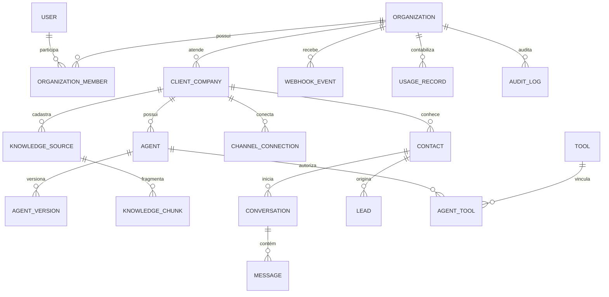

# Modelo de dados

O modelo usa PostgreSQL via Prisma 7 e mantém dados transacionais, auditoria e vetores no mesmo banco para reduzir complexidade operacional no MVP. O schema executável está em `prisma/schema.prisma`; este documento explica intenção, relações e cuidados que o schema sozinho não garante.

## Relações principais



`Organization` é o tenant. `ClientCompany` é a empresa cliente operada dentro desse tenant. Na instalação inicial, a organização da ZYRVA pode administrar várias empresas clientes; o modelo também permite organizações separadas futuramente.

## Catálogo de entidades

| Entidade Prisma | Finalidade | Dados relevantes |
| --- | --- | --- |
| `User` | identidade do operador | e-mail único, hash opcional, bloqueio, admin da plataforma |
| `Organization` | fronteira do tenant | localidade, limites mensais e configurações |
| `OrganizationMember` | usuário + organização + papel | papel único por associação |
| `ClientCompany` | cliente comercial da ZYRVA | ramo, status, fuso, contato, indicador demo |
| `Agent` | configuração editável atual | rascunho, status e versão publicada |
| `AgentVersion` | snapshot imutável para revisão/publicação | versão, configuração, autores e datas |
| `KnowledgeSource` | documento, FAQ, URL ou catálogo | hash, texto extraído, tipo e processamento |
| `KnowledgeChunk` | trecho recuperável | sequência, conteúdo, metadados e `vector(1536)` |
| `ChannelConnection` | vínculo com canal oficial | `phoneNumberId`, estado e campos reservados para token cifrado; credencial não persistida neste MVP |
| `Contact` | pessoa que conversa | telefone, nome, e-mail, opt-out e consentimento |
| `Lead` | interesse comercial | etapa, preferências, responsável, origem e consentimento |
| `Conversation` | estado do atendimento | modo IA/humano, status, resumo e dados coletados |
| `Message` | unidade de conversa ou nota interna | direção, autor, tipo, entrega, fontes e confiança |
| `Tool` | ação declarativa permitida | JSON Schema, risco e confirmação |
| `AgentTool` | autorização de ferramenta por agente | habilitação e configuração restrita |
| `Automation` | gatilho, condições e ações declarativas | status, cooldown e limite de execução |
| `WebhookEvent` | caixa de entrada idempotente | provedor, ID externo, hash, tentativas e estado |
| `UsageRecord` | consumo e telemetria de negócio | tokens, duração, modelo, custo estimado e tipo |
| `AuditLog` | trilha de mudanças sensíveis | ator, ação, entidade, correlação e diffs redigidos |

## Estados importantes

### Agente e versão

- `Agent`: `DRAFT`, `ACTIVE`, `PAUSED`, `ARCHIVED`.
- `AgentVersion`: `DRAFT`, `PUBLISHED`, `RETIRED`.
- `Agent.publishedVersionId` aponta para o snapshot que atende conversas novas.
- publicar cria/seleciona versão imutável; não se edita JSON já publicado.
- restaurar uma versão antiga cria nova versão ou torna um snapshot validado o ativo, preservando história e auditoria.

### Conversa

Status: `NEW`, `AI_ACTIVE`, `WAITING_CUSTOMER`, `WAITING_HUMAN`, `HUMAN_ACTIVE`, `RESOLVED`, `ARCHIVED`.

Modo: `AI`, `HUMAN`, `PAUSED`. O modo é a barreira de envio; o status comunica a etapa ao operador. Ao assumir manualmente, a mesma transação deve alterar modo/status, atribuir usuário e criar auditoria.

### Entrega e webhook

`Message.status` segue `RECEIVED`, `QUEUED`, `SENT`, `DELIVERED`, `READ` ou `FAILED`. `WebhookEvent.status` separa recebimento, fila, processamento, descarte e falha. Atualizações da Meta podem chegar fora de ordem; nunca rebaixe um estado terminal apenas pela ordem de chegada.

### Lead

Etapas: `NEW`, `QUALIFYING`, `QUALIFIED`, `PROPOSAL`, `NEGOTIATION`, `CONVERTED`, `LOST`. `convertedAt` só é preenchido por ação humana ou evento confiável, não por inferência do modelo.

## Isolamento multiempresa

Todas as entidades de negócio relevantes carregam `organizationId`. As regras de acesso são:

1. derive a organização da sessão autenticada ou da conexão de canal validada;
2. inclua `organizationId` no filtro da consulta, alteração e exclusão;
3. valide que todos os IDs relacionados pertencem à mesma organização antes de gravar;
4. use transação para a validação e a escrita quando houver risco de corrida;
5. negue por padrão e registre tentativa cruzada sem revelar dados;
6. teste cada repositório/caso de uso com dois tenants.

Usuários são globais; campos como `assignedToId`, autores de versão e ator de auditoria não carregam tenant próprio. Antes de atribuir/registrar, a aplicação deve confirmar associação ativa em `OrganizationMember` (exceto ação administrativa de plataforma explicitamente autorizada).

### Defesa no banco

As relações declaradas no Prisma usam, em sua maioria, o `id` do registro relacionado. A migração inicial acrescenta índices únicos `(organizationId, id)` e chaves estrangeiras compostas para as relações de negócio, impedindo uma referência cruzada mesmo quando a escrita não passa pelo Prisma. Os guards da camada de aplicação continuam obrigatórios, pois também controlam papel, operação e resposta de erro.

Row-Level Security ainda não está ativado. Ela pode ser uma defesa adicional em produção, mas exige contas distintas para migração/runtime, política por tabela e testes que provem que o pool não reaproveita contexto de tenant.

## Unicidade e idempotência

- membro: `(organizationId, userId)`;
- empresa: `(organizationId, slug)`;
- agente: `(organizationId, clientCompanyId, name)`;
- versão: `(agentId, version)`;
- fonte por conteúdo: `(organizationId, clientCompanyId, contentHash)`;
- contato/lead: `(organizationId, clientCompanyId, phone)`;
- mensagem externa: `(channelConnectionId, externalId)`;
- evento: `(provider, externalEventId)`;
- ferramenta: `(organizationId, key)`.

Normalize telefone para E.164 antes de testar duplicidade. E-mail deve ser normalizado de forma conservadora; não altere a parte local com regras específicas de um provedor.

## Embeddings e `pgvector`

`KnowledgeChunk.embedding` usa `vector(1536)`, compatível com a configuração atual de `text-embedding-3-small`. A migração habilita a extensão `vector`; o Docker Compose também a cria de forma idempotente.

Uma consulta semântica deve obrigatoriamente restringir `organizationId` e, conforme o caso, `clientCompanyId`/`agentId` antes de aplicar distância. O Prisma trata o campo como `Unsupported`, então busca vetorial usa SQL parametrizado; valores de tenant, IDs, limite e vetor nunca são interpolados em string.

Ao trocar modelo ou dimensão:

1. crie uma versão de índice/coluna nova;
2. gere embeddings em background com modelo registrado no metadado;
3. compare recuperação em um conjunto de avaliação;
4. altere a leitura somente após completar o backfill;
5. remova o índice antigo apenas depois do rollback não ser mais necessário.

## JSON e esquemas declarativos

Campos `Json` aumentam a velocidade do MVP, mas todo JSON que gera comportamento precisa de esquema versionado e validação Zod na entrada e na leitura:

- `Agent.currentDraft` e `AgentVersion.configuration`;
- `Tool.inputSchema` e `AgentTool.config`;
- `Automation.trigger`, `conditions` e `actions`;
- payloads, metadados e dados coletados.

Nunca execute código armazenado nesses campos. Versões antigas precisam de migração de configuração ou interpretador compatível.

## Dados pessoais e retenção

Dados pessoais aparecem principalmente em `Contact`, `Lead`, `Conversation`, `Message`, fontes de conhecimento, webhooks e auditoria. Defina períodos por finalidade e contrato; o software não deve assumir prazo jurídico universal.

Recomendações de implementação:

- guarde payload bruto de webhook apenas pelo tempo necessário para idempotência/investigação;
- separe exclusão operacional de retenção legal comprovada;
- anonimize telefone, e-mail, texto e metadados relacionados em solicitações válidas;
- preserve auditoria mínima sem manter conteúdo pessoal desnecessário;
- registre consentimento com origem e data, sem tratar ausência como consentimento;
- backups também precisam de expiração e procedimento de restauração com exclusões posteriores.

Consulte [security-lgpd.md](security-lgpd.md) antes de definir prazos.

## Migrações

Desenvolvimento:

```powershell
npm run db:migrate -- --name descricao_curta
```

Produção/CI:

```powershell
npm run db:deploy
```

Não use `prisma db push` em produção. Revise SQL, locks, backfill, extensão e estratégia de rollback. O job de migração deve executar uma vez antes de liberar a nova revisão.
